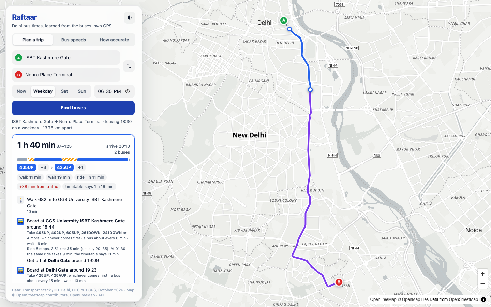
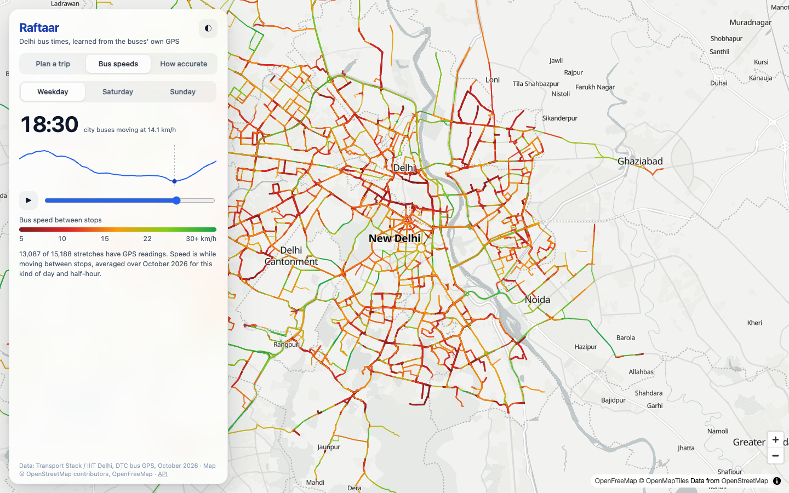
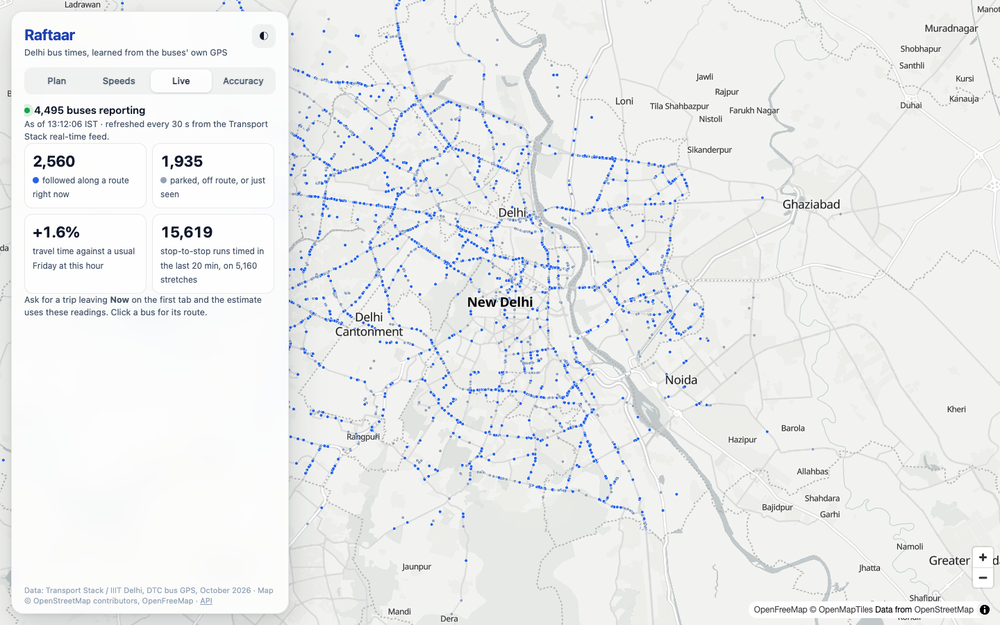
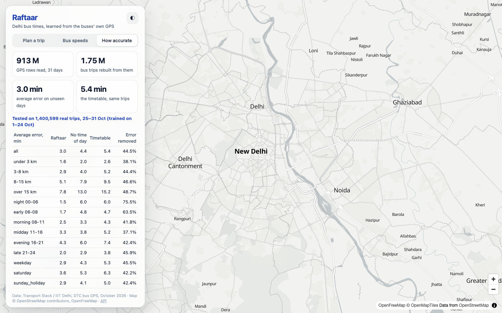

# Raftaar

**Delhi bus travel times learned from the buses' own GPS, and a journey planner built on them.**
Transport Stack Hackathon 2026, Problem 1 (real-time bus traffic model and journey planner).

**Try it:** https://gyanps-raftaar.hf.space (map) · https://gyanps-raftaar.hf.space/docs (API)

Delhi's published bus timetable gives a route the same duration at every hour of the day: it assumes a constant speed of roughly 18 to 20 km/h, at 3 am and at 6 pm alike. The buses themselves say otherwise. Raftaar reads one month of bus GPS (913 million rows), rebuilds 1.75 million bus trips from it, and learns how long each of 15,188 stop-to-stop stretches takes by half-hour and by kind of day. A journey planner then answers "from here to there, leaving at this time" with times that come from what buses actually did.

| Plan a trip | Bus speeds across the city |
|---|---|
|  |  |
| **Buses on the road right now** | **How accurate** |
|  |  |

**Submission documents:** [Proposal](docs/PROPOSAL.md) · [Technical note](docs/TECH_NOTE.md) · [Validation report](docs/VALIDATION.md)

## What it gets right

Tested on 1,400,599 real board-to-alight bus trips from 25 to 31 October, days the model never saw (it was trained on 1 to 24 October):

| Estimate | Average error | Error as share of trip time | Trips within 10% |
|---|---:|---:|---:|
| **Raftaar + the last 20 minutes of buses** (leaving now) | **2.7 min** | **14.4%** | **47.0%** |
| **Raftaar, typical day** (any future time) | **3.0 min** | **16.0%** | **43.6%** |
| Same GPS data, no time of day | 4.4 min | 23.3% | 29.9% |
| Published timetable | 5.4 min | 28.9% | 20.5% |

The full table by distance, time of day and day type is written by `make backtest` to `artifacts/backtest.md`; see [docs/VALIDATION.md](docs/VALIDATION.md).

One route as an example, ISBT Kashmere Gate to Nehru Place on route 425 (17.7 km): the timetable says 54 minutes all day. The model, built from what buses did on each stretch, says about 39 minutes at 3 am, 64 at 9 am and 90 at 6 pm.

## Run it

You need [uv](https://docs.astral.sh/uv/) and, to rebuild from the raw archive, `7zz` (7-Zip). Python 3.12 is installed by uv.

**Quickest, no data needed** (downloads the fitted model, 32 MB, from the public demo):

```bash
git clone https://github.com/gyanps/raftaar.git && cd raftaar
make demo       # about a minute
make serve      # http://localhost:8000
```

**From the raw data:**

```bash
git clone https://github.com/gyanps/raftaar.git && cd raftaar
# put the organisers' files here:
#   data/delhi-dtc-bus-gtfs-rt-2026-10.7z          (16 GB; the raw GPS archive)
#   data/gtfs/*.txt                                (the static Delhi bus GTFS, unzipped)
make all        # about 15 minutes on a laptop; needs about 12 GB of free disk (the archive is unpacked one day at a time)
echo 'TRANSPORT_STACK_API_KEY=...' >> .env   # optional: the real-time feed key from delhi.transportstack.in
make serve      # http://localhost:8000 (map) and http://localhost:8000/docs (API reference)
make test
```

`make all` runs six steps, each of which can be run alone:

| Step | What it does | Time |
|---|---|---|
| `make gtfs` | Static GTFS to route patterns, each stop's distance along its route, and stop-to-stop stretches shared between routes | 5 s |
| `make reduce` | Unpacks one day at a time and keeps one row per real GPS fix (31M rows a day become about 18M) | 8 min |
| `make match` | Follows every bus along its route and records when it reached and left each stop | 5 min |
| `make model` | Learns travel time for every stretch by half-hour and day type | 1 min |
| `make planner` | Counts how often each route really runs; finds stops within walking distance of each other | 5 s |
| `make backtest` | Trains on 1 to 24 October, tests on 25 to 31 October | 1 min |

## The API

```
GET /api/journeys?from=ISBT Kashmere Gate&to=Nehru Place Terminal&depart=08:30&day=weekday
```

`from` and `to` take a stop name (or part of one) or `lat,lng`. `depart` takes `now`, `2026-11-24T08:30`, or `HH:MM` with `day=weekday|saturday|sunday`. Times are Indian Standard Time.

Each option lists the walk to the first stop, where to board, every route worth taking there (a rider takes whichever comes first), where to get off, any change of bus, the walk to the destination, and the total with a range. For each bus ride it also gives the same ride at the quietest half-hour and the timetable's figure, so the effect of traffic is visible.

| Endpoint | Returns |
|---|---|
| `/api/journeys` | Journey options between two places |
| `/api/traveltime` | The direct bus ride between two stops for every half-hour of a day, with a range |
| `/api/traffic` | Bus speed on every stretch for each half-hour of a typical day |
| `/api/segments` | The geometry of every stretch |
| `/api/places` | Stop search by name, tolerant of spelling slips |
| `/api/live/status` | Whether live data is flowing, and how the city is running against a usual day |
| `/api/live/vehicles` | Where the buses are right now |
| `/api/about` | What the model was built from and the backtest results |

Interactive reference: `/docs`.

## Score your own test cases

To check the model against a list of trips, put them in a CSV (or a JSON list) and run:

```bash
make predict CASES=cases.csv        # writes cases.predictions.csv next to it
```

It works straight after `make demo`; no raw data and no server are needed. Column names are matched loosely, so most files work as they are:

| A case needs | Accepted columns |
|---|---|
| Where from, where to | a stop name or `lat,lng` in `from` / `to` (also `origin`, `source`, `destination` ...), **or** a GTFS stop id in `from_stop_id` / `to_stop_id`, **or** `from_lat`, `from_lng`, `to_lat`, `to_lng` |
| When | `depart` (also `departure_time`, `time`, `datetime`, `timestamp`): `2026-10-28 08:30`, an ISO time with a zone, epoch seconds, or `08:30` with a `date` or a `day` column (weekday / saturday / sunday) |
| Optional: the route | `route` (`425` or `425UP`) or `route_id`; the bus ride is then priced on that route |
| Optional: the observed time | `actual_min`, `observed_min`, `actual_s`, `travel_time_s` ...; the file is then scored |

Each row gets two answers, because "travel time" can mean either:

- **`door_to_door_min`**: the whole journey from the planner, with its range and its parts: `walk_min`, `wait_min`, `ride_min`, the number of buses and the routes taken. The timetable's figure for the same journey is beside it.
- **`bus_ride_min`**: time on one bus from the boarding stop to the alighting stop, with its 10th to 90th percentile range and the timetable's figure. This is what the backtest measures.

A row that cannot be read (an unknown stop, a missing time) gets a `note` saying why and the rest still run. With an observed-time column the command prints the average error, the share of cases within 10%, the bias, and the timetable's error on the same cases. The observed time is taken as door to door; add `--actual-is ride` if it is time on the bus only. [validation/sample_cases.csv](validation/sample_cases.csv) shows every accepted layout.

A file has no "now", so these answers are the typical-day model for the given date and time. For a trip leaving now with the live adjustment, ask `/api/journeys?depart=now` on a server started with the feed key.

## How it works, in short

1. **Fixes.** The feed re-logs a bus every 10 seconds whether or not it has a new position; duplicates and positions outside Delhi are dropped.
2. **Which route, how far along.** Each bus is followed along the route shapes it was labelled with (and the opposite direction of each), by distance along the shape. A trip is a stretch of steady forward progress. The feed's own route label is wrong for about one fix in five, so geometry decides and the label only breaks ties.
3. **Stop events.** For every stop on a trip: when the bus entered a 30 m zone around it and when it left. Time between stops (running, signals, congestion) and time at stops (dwell) are kept apart.
4. **Profiles.** For every stretch, the expected seconds per metre by day type (weekday, Saturday, Sunday or holiday) and half-hour. Thin cells borrow from neighbouring half-hours and from the city's overall daily rhythm.
5. **Trips.** A ride from stop a to stop b is the stretches between them plus the dwells in between, added up with the clock moving. Real trips are replayed through this to give a range.
6. **Live.** How the network ran in the last 20 minutes (city-wide, and stretch by stretch) adjusts the estimate, fading with how far ahead the bus will reach each stretch. Scored by replaying the test week with only the GPS known before each trip left: average error 2.7 min. With `TRANSPORT_STACK_API_KEY` in `.env` the server polls the real-time feed every 30 seconds and answers trips leaving now in live mode; without it, or while the feed is down or warming up, every answer is the typical-day model and says so.
7. **Planner.** A round-based search over route patterns. Waiting time comes from how often buses were really seen (about half of the timetable's trips appear in the GPS). Routes that share a stretch are pooled, because a rider takes the first useful bus.

More in [docs/TECH_NOTE.md](docs/TECH_NOTE.md).

## Layout

```
raftaar/geo         polyline maths, a flat local grid for Delhi
raftaar/pipeline    gtfs.py, reduce.py, match.py
raftaar/model       observations.py, profile.py, traveltime.py
raftaar/live        feed.py (GTFS-Realtime), state.py (rolling match), service.py (polling)
raftaar/planner     build.py, raptor.py, journeys.py
raftaar/api         main.py (FastAPI), places.py
raftaar/validation  backtest.py, metrics.py, predict.py (score a file of test trips)
web/                the map screen (no build step; MapLibre GL)
tests/              pytest
```

## Data and credits

Bus GPS, ticketing and static GTFS: Transport Stack / IIIT Delhi, from the DTC bus feed, shared for the Transport Stack Hackathon 2026. The raw data is not in this repository.
Map: © OpenStreetMap contributors, tiles and style by OpenFreeMap. Map library: MapLibre GL JS.

Team: Gyan Pratap Singh, Khalid Khan. Code: MIT licence.
